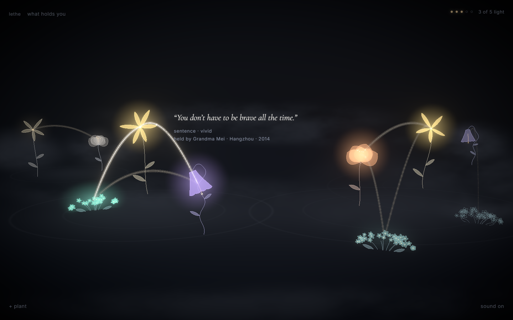
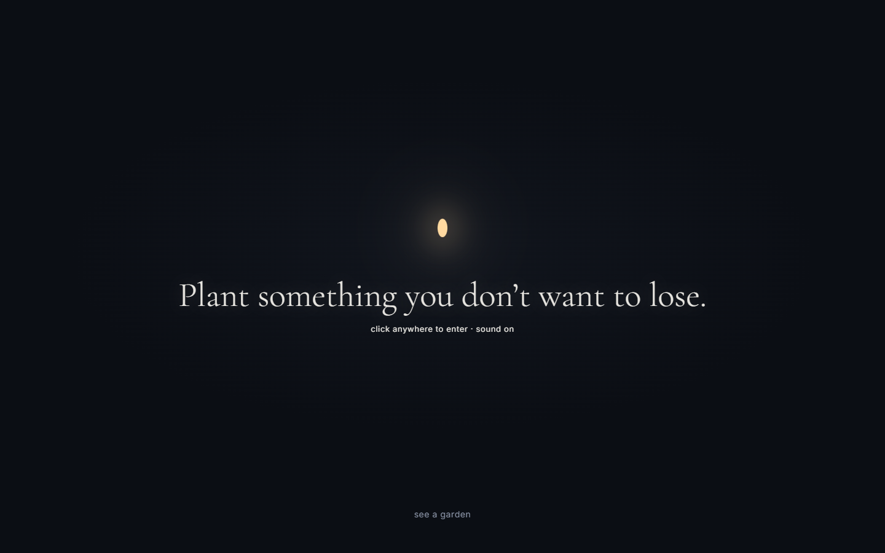
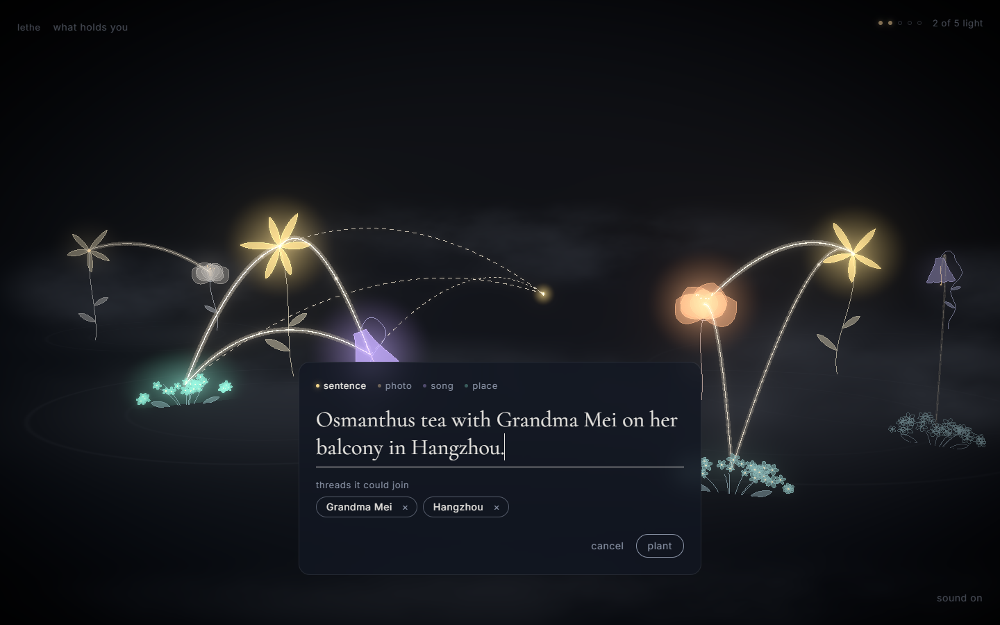
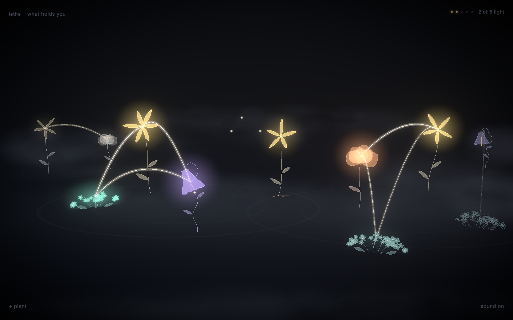
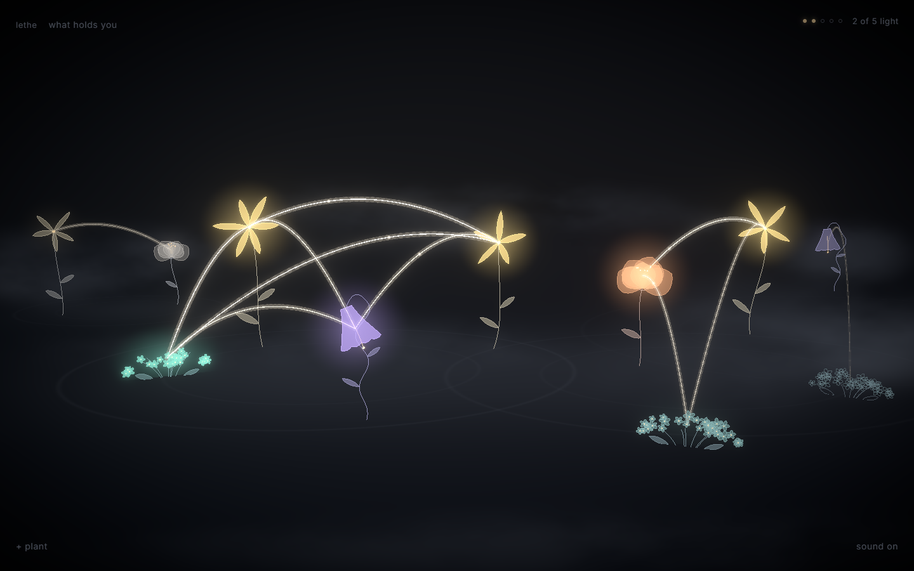
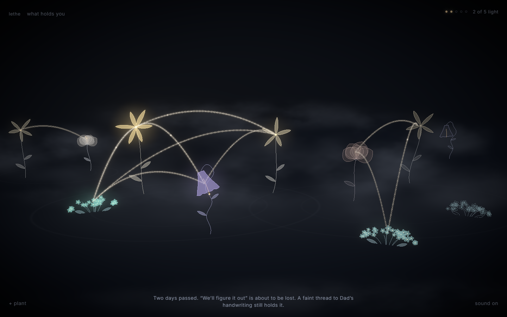
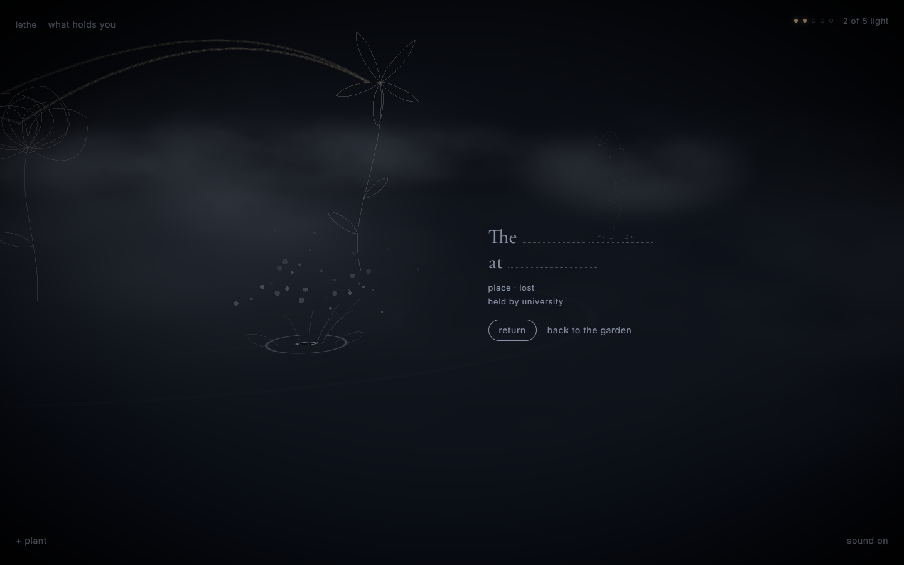
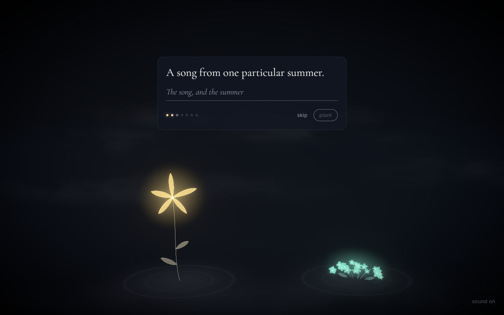
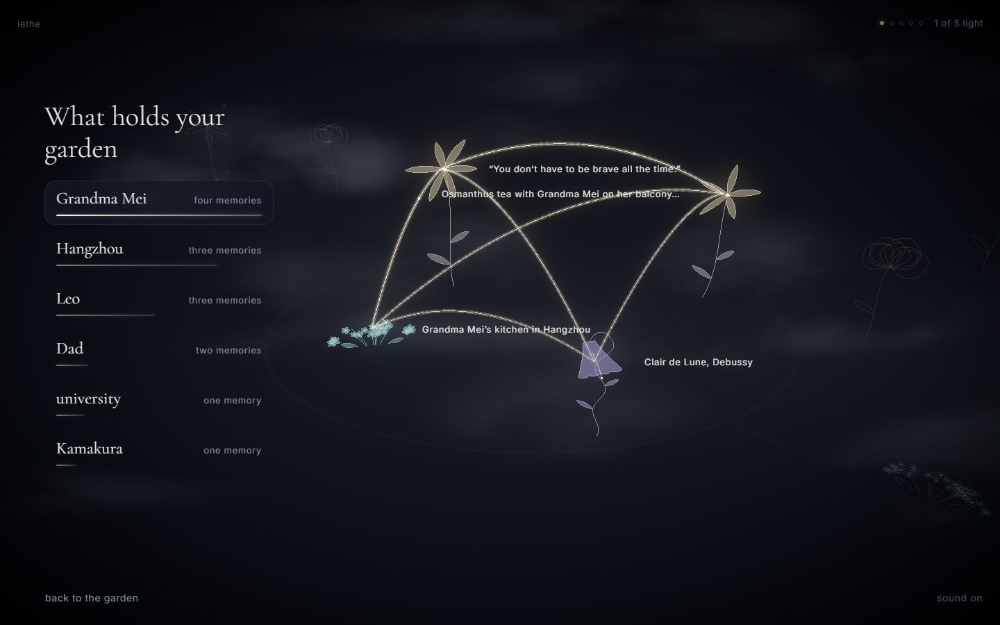

# Lethe

*A garden that forgets.* Plant memories as flowers. Fog slowly takes them. Only connected memories survive.



## Screens

| | |
|---|---|
|  **The threshold.** One line, one seed. The first click starts the sound. |  **Planting.** While you write, the garden finds who and where the memory shares, and dashed threads reach out from the waiting seed. |
|  **The bloom.** The flower grows from its seed in 1.6s... |  **...and its first threads light.** Light runs to each neighbour, and their notes resolve into a chord. |
|  **Two weeks later.** Fog rolls in and memories fade one after another. The whisper names what is at risk and what still holds it. |  **A dark seed.** A lost memory keeps a seed, and its words begin to go. It can always be returned to. |
|  **Your own garden** begins with seven prompts, and is kept only in your browser. |  **What holds your garden.** The people and places your memories share, ranked by how much they hold up. |

## Run

```
npm install
npm run dev               # http://localhost:5173
```

Press <kbd>`</kbd> in the garden for the hidden time slider.

## The 90-second demo

Live: [lethe-nine.vercel.app](https://lethe-nine.vercel.app). Sound on, a 1440 × 900 window or larger. Each step says what to do, then what the garden does.

| | do | the garden |
|---|---|---|
| 0:00 | Open the site. Click **see a garden**. | "Plant something you don’t want to lose." The first click starts the drone, and ten memories rise out of the dark. |
| 0:10 | Hover the yellow flower on the left: "You don’t have to be brave all the time." | Its note sounds. Its threads to Grandma Mei’s kitchen and Clair de Lune brighten, and the rest of the garden dims: this is what holds the memory up. |
| 0:20 | Click it, then **tend**. | A mote of light flies from the light counter, the flower swells, a bell rings, and a ripple runs along each thread to its neighbours, who answer one by one. |
| 0:30 | **+ plant** → **sentence** → type *Osmanthus tea with Grandma Mei on her balcony in Hangzhou.* → **plant**. | While you type, "threads it could join" finds Grandma Mei and Hangzhou, and dashed threads reach out from a waiting seed. Planted, the flower grows over 1.6s, then light runs to its neighbours and the new threads resolve into a chord. Works with no tagging key. |
| 0:50 | Press <kbd>`</kbd>, drag the slider to **+14**, click **arrive**, press <kbd>`</kbd> again. | Two weeks pass in a few seconds: fog rolls in, flowers fade to outlines one after another, and the library rooftop and Satie dissolve into particles and leave dark seeds. Their notes bend down and fade. The whisper says what happened and what still holds the next memory at risk. |
| 1:10 | Click the library rooftop’s dark seed (far right), then **return**. | It comes back as a ghost for one light. A loss can always be returned to. |
| 1:20 | **what holds you** (top left). | "What holds your garden": Grandma Mei first, with four memories. Everything she doesn’t hold recedes, and her threads light up across the garden. **back to the garden** to finish. |

No time to drive it? Click **watch a season** (on the opening screen, or top left in the demo garden) and the garden plays the same story by itself in about 85 seconds; any click or key hands it back. To run it again, press <kbd>`</kbd> and click **reset demo garden**. `?demo` skips the threshold, and `?days=21` opens three weeks ahead. Your own garden (**click anywhere to enter** on the threshold) is kept in your browser, separate from the demo.

## Tagging

Each memory is tagged with the people, places and feelings it mentions, and memories that share them are threaded together. **No key is needed:** an offline tagger runs in the browser (the [compromise](https://github.com/spencermountain/compromise) NLP library, relation words like "Mom" and "my sister", and a small feelings word list).

A tagging service is an optional upgrade, set server-side only (`.env` locally, Environment Variables on Vercel):

| key | provider | notes |
|---|---|---|
| `GROQ_API_KEY` | Groq, `openai/gpt-oss-20b` | free tier, from [console.groq.com/keys](https://console.groq.com/keys) |
| `ANTHROPIC_API_KEY` | Claude, `claude-haiku-5-5` | used instead of Groq when both are set |

Planting never waits for the service: the flower grows with offline tags, and better tags replace them if the service answers within 2.5s. After a "no key" reply the app stops asking; after a rate limit it waits a few minutes.

```
cp .env.example .env      # optional: add GROQ_API_KEY or ANTHROPIC_API_KEY
```

## Docs

| | |
|---|---|
| [SUBMISSION.md](SUBMISSION.md) | **hackathon submission:** topic, design decisions, AI use, similar projects, simulated data, credits |
| [docs/build-plan.md](docs/build-plan.md) | phases, mini-tasks, schedule, cut line, demo path |
| [docs/decisions.md](docs/decisions.md) | resolved conflicts between plan, screens and design system |
| [docs/architecture.md](docs/architecture.md) | diagrams: system, modules, states, data model, flows |
| [docs/systems.md](docs/systems.md) | forgetting, threads, tending, time, tagging, sound |
| [docs/scene-spec.md](docs/scene-spec.md) | the 3D look in numbers, hero moment timings |
| [CLAUDE.md](CLAUDE.md) | rules for Claude and Codex ([AGENTS.md](AGENTS.md) points here) |
| [lethe-design-system/](lethe-design-system/README.md) | tokens, type, DOM components, sample content |

## Layout

```
src/engine/    pure garden rules + tests (no rendering, time passed in)
src/data/      the ten sample memories and first-planting prompts
src/store/     Zustand store: the only caller of the engine
src/scene/     React Three Fiber garden (flowers, threads, fog, fx)
src/ui/        design-system DOM components and screens
src/tagging/   offline tagger (default) + client for /api/tag with back-off
server/, api/  tagging handler (Vercel function; Vite middleware in dev)
scripts/       forgetting simulation
```
