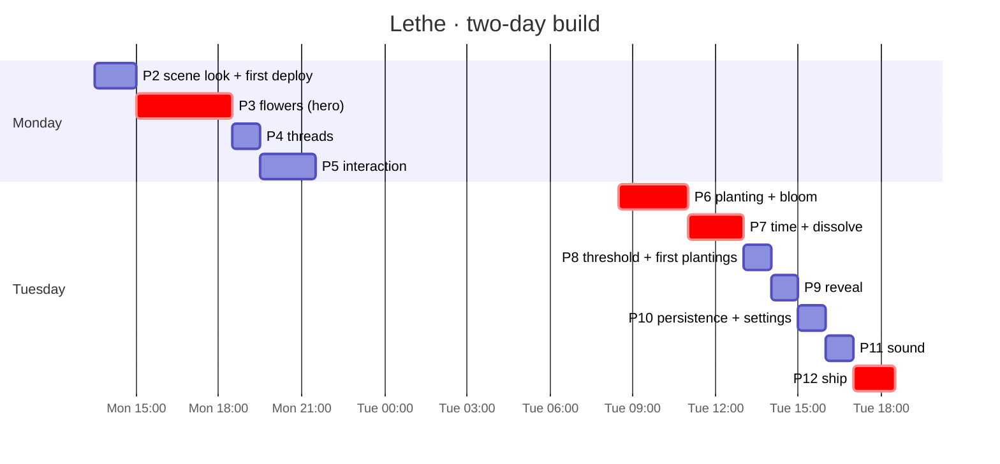

# Build plan

**Deadline:** Tuesday 13 October, evening. **Start:** Monday 12 October, about 13:30. That's roughly 18 working hours across two days, in 3D.

The plan is ordered so that **a demoable garden exists at every point after Monday evening**. Each phase ends with a gate: a screenshot or a check. If a gate fails, fix it before moving on, or cut scope below the line. Never carry a broken look into the next phase.

> If "Tuesday" means **20 October**, keep the same order, double every time box, and move the cut line to include all *should* phases plus sound.

## Status

| | Phase | Tier | Box | Status |
|---|---|---|---|---|
| P0 | Setup: repo, deps, docs, CLAUDE.md | must | — | ✅ done |
| P1 | Garden engine + tests + simulation | must | — | ✅ done (16 tests, sim tuned) |
| P2 | Scene look: fog, ground, camera, post | must | 1.5h | 🟨 done except P2.1 deploy (needs your Vercel login) |
| P3 | **Flowers**: procedural Bloom in 3D, 4 kinds × 4 states | must | 3.5h | ✅ done (ghost petals falling → P7) |
| P4 | Threads: arcs, pulse, motes, hover | must | 1h | ✅ done |
| P5 | Interaction: hover, focus, tend, ripple, whispers | must | 2h | ⬜ partly |
| P6 | Planting: overlay, tagging, suggested threads, **the bloom** | must | 2.5h | ⬜ partly |
| P7 | Time: return replay, **the dissolve**, dark seed, return | must | 2h | ⬜ partly (engine done) |
| — | **cut line: below here is optional if behind** | | | |
| P8 | Threshold + first plantings + "a season passes" | should | 1h | ⬜ |
| P9 | Reveal: "what holds you" | should | 1h | ⬜ |
| P10 | Persistence (Dexie) + settings (export, let the garden go) | should | 1h | ⬜ |
| P11 | Sound (Tone.js) | could | 1h | ⬜ |
| P12 | Ship: perf, deploy, demo script, look log | must | 1.5h | ⬜ (deploy early in P2) |

## How to work each task

1. Open a fresh Claude Code or Codex session. Paste the phase prompt, then tick the tasks one at a time.
2. **One task per session or commit.** `git commit` after every working step, so a bad change is one revert away.
3. Visual tasks: run `npm run dev`, take a screenshot, compare it to the named screen, and save approved looks to `docs/look-log/YYYYMMDD-HHMM-<what>.png`.
4. After a phase, have the *other* tool review it against `docs/scene-spec.md` and `docs/decisions.md`.
5. Keep `npm test` and `npm run typecheck` green. The engine has no rendering, so test it, don't eyeball it.

---

## P2 · Scene look (1.5h, must)

**Goal:** the empty stage already feels like the screens: night, fog and depth. *Look ref:* screens p3 (garden, no UI) and p14 (empty garden).

- [ ] **P2.1 Deploy first (20m).** `npx vercel` → link → (optional) set `GROQ_API_KEY` in project env → deploy. Check that `/api/tag` returns 200 in production. *Done when:* you have a live URL. (De-risks P12.)
- [x] **P2.2 Fog banks (40m).** `src/scene/fog/FogBanks.tsx`: 8 camera-facing planes with an fbm noise `ShaderMaterial` in `fog`, opacity 0.06, drifting on 40–90s loops; extra banks at opacity 0.14 in front of ghost flowers. Uniform `uDensity` from the share of faded memories. *Done when:* fog visibly drifts and is thicker over m9 and m10.
- [x] **P2.3 Ground + camera (20m).** Soft radial lighten under each cluster (one shader plane). drei `OrbitControls` with the limits in scene-spec (azimuth ±25°, polar 55–85°, distance 4–16, no pan), damping on, and the drift resuming after 5s idle. Scroll out → overview.
- [x] **P2.4 Post + quality (10m).** Wrap the composer in drei `PerformanceMonitor`; on decline, drop to low quality (scene-spec § Post-processing).
- **Gate:** screenshot vs screen p3. Is it dark enough, the fog soft, nothing grey or "Three.js demo"? Save it to the look log.

> **Prompt:** "Read CLAUDE.md, docs/scene-spec.md (World, Fog, Post-processing) and src/scene/GardenScene.tsx. Do task P2.2 from docs/build-plan.md: create src/scene/fog/FogBanks.tsx and mount it in GardenScene. Use only colours from src/engine/color.ts TOKENS. Show me how to check it visually."

## P3 · Flowers, the hero (3.5h, must)

**Goal:** the four flower families, in four states, look like the design system's Bloom page, standing in 3D. *Look ref:* design-system p12 (Bloom grid), screens p2 (focus flower).

- [x] **P3.1 Generator port (60m).** `src/scene/flower/generator.ts`: port `Bloom` from `lethe-design-system/components/bundle.js` into a pure function `generateFlower(kind, seed, size) → { stems: Vec2[][], petals: {path: Vec2[], at, angle, back}[], leaves, florets, head, anchors }` in a flower-local 2D plane (y up, units = px/100). Reuse `rng` from `src/ui/ds.tsx` (move it to `src/engine/rng.ts`). Add a unit test that the same seed gives the same output. *Done when:* the test passes and the output count matches the SVG (petal count, etc.).
- [x] **P3.2 Geometry + materials (75m).** `src/scene/flower/geometry.ts` builds merged BufferGeometries: stem tubes, cupped petal shapes, outlines, place florets (instanced), and the centre. `src/scene/flower/Flower.tsx` renders them with the per-flower uniforms table, Y-billboarded toward the camera. Replace `PlaceholderFlower` in GardenScene.
- [x] **P3.3 States (40m).** Drive `uColor/uFill/uLine/uGlow/uDroop` from `views` with a 3s lerp. Ghost: outline only. Lost: faint outline plus drifting particles from `anchors` (points, 7–13s drift).
- [x] **P3.4 Halo + sway + breathing (25m).** Halo quad, breathing 7s; seeded sway; centre dot feeds bloom.
- [x] **P3.5 Flower sandbox (20m).** `?sandbox=flowers` renders the 4×4 grid (kinds × states) with a seed input and sliders (size, cup, glow) via `leva` (`npm i leva`). Tune by eye. *Built without leva:* `?sandbox=flowers&seed=m1&size=160`, plus a size slider.
- **Gate:** sandbox screenshot next to design-system p12, and garden screenshot next to screens p3. Each flower should be recognisably its family, and no two alike. Save both.

> **Prompt:** "Read CLAUDE.md, docs/scene-spec.md § Flowers, and the Bloom function in lethe-design-system/components/bundle.js. Do P3.1: port the generator to src/scene/flower/generator.ts as pure data (no SVG, no React) and add a determinism test. Keep the exact rng call order so flowers match their 2D twins."

## P4 · Threads (1h, must)

*Look ref:* screens p1/p3, design-system p13.

- [x] **P4.1 Thread shader (30m).** `src/scene/thread/ThreadArc.tsx`: core + glow lines as in scene-spec; a pulse via a custom line material (or a moving sprite along the curve), period seeded 4–7s; motes when s > 0.3.
- [x] **P4.2 Hover + flicker + suggested style (30m).** Brighten or dim on hover (already in the skeleton), flicker to ghost ends, and a dashed variant for suggested threads (used in P6).
- **Gate:** hover Grandma Mei's sentence → its threads glow and the rest dim. The faint 9–10 thread is barely there. *Passed:* the sentence's two threads light; kitchen–Clair de Lune dims with the rest, since it isn't the hovered flower's thread (design system: "brighten its threads"). Sandbox: `?sandbox=threads`.

## P5 · Interaction (2h, must)

*Look ref:* screens p1 (hover), p2 (focus).

- [ ] **P5.1 Recollection beside the flower (40m).** Project the flower head to the screen each frame (`vector.project(camera)`). Place the Recollection `space-3` away on the side with more open ground, with `space-5` clear. Hover uses `memory` (24px); focus uses `size="lg"` (32px) on the right half (screen p2).
- [ ] **P5.2 Tend feedback (40m).** On `tend` events: a light mote travels from the LightCounter to the flower (0.6s), the counter dot dims, the flower brightens over 1.2s, and a ripple runs along each thread to neighbours (pulse at 2× brightness).
- [ ] **P5.3 Whispers (20m).** Move the whisper logic out of App into `src/ui/whispers.ts` following systems.md § Return summary → words. One at a time, hide after 6s or on pointer move.
- [ ] **P5.4 Keyboard + a11y (20m).** <kbd>N</kbd> opens planting, <kbd>Esc</kbd> closes focus, <kbd>Tab</kbd> cycles flowers (hidden buttons with `aria-label` = first words), focus ring per design system, and `prefers-reduced-motion`.
- **Gate:** hover, focus, tend, ripple and let go, end to end, with nothing jumping.

## P6 · Planting + the bloom (2.5h, must)

*Look ref:* screens p4, p5, p6, and the bloom storyboard p17.

- [ ] **P6.1 Plant overlay (40m).** `+ plant` (bottom centre, as in the screens) or <kbd>N</kbd> → Overlay "What kind of memory?" with four seed dots (screen p4) → the field (p5). Photo: a file input; extract the dominant colour with a 32×32 canvas average, ignoring near-black and near-white; store the blob in P10.
- [ ] **P6.2 Live tagging + suggested threads (40m).** Debounce 600ms while typing → offline tags at once, then `apiTag()` (it already backs off after 503/429) → show "threads it could join" chips with × to reject (p6) → dashed suggested threads in the scene from a ghost seed hovering where the flower will grow. Abort stale requests.
- [ ] **P6.3 The bloom (50m).** `src/scene/fx/BloomGrowth.tsx`: the 6 beats from scene-spec § The bloom, driven by the `bloom` event. Sandbox at `?sandbox=bloom` with a replay button.
- [ ] **P6.4 The first thread (20m).** If the new memory's first thread forms, run the light pulse from it to the neighbour before the thread fades in. Sound hook (P11).
- **Gate:** plant "Osmanthus tea with Grandma Mei on her balcony in Hangzhou." It should grow, thread to m1 and m2, and the Mei cluster should brighten. Works with no API key too (local tags).

## P7 · Time, return, dissolve (2h, must)

*Look ref:* screens p11 (return), p16 (neglected), dissolve storyboard p18.

- [ ] **P7.1 Return replay (45m).** On `arrive()`, render `states.before`, then ease each flower to `states.after` over 3s, staggered, while fog density rises. The whisper line comes from the summary. About-to-be-lost ghosts glow once (a 1.5s halo pulse) to invite a tend.
- [ ] **P7.2 The dissolve (45m).** `src/scene/fx/Dissolve.tsx`: the 6 beats from scene-spec. It ends in a **dark seed** (small dark ellipse + faint ring) that stays clickable and opens focus with `return`.
- [ ] **P7.3 Slider polish (15m).** The hidden slider (<kbd>`</kbd>) previews smoothly; "arrive" plays the replay. Add a "reset demo garden" button in the slider panel.
- [ ] **P7.4 Neglected-garden check (15m).** Slide +28 days → the garden should look like screen p16: mostly outlines and fog, with a few connected memories still glowing.
- **Gate:** the demo story works: open → hover → tend Leo → slide 2 weeks → arrive → the rooftop dissolves → return it.

---

## ✂ Cut line. Everything above makes a complete demo.

## P8 · Threshold + first plantings (1h, should)

*Look ref:* screens p7, p8–p10, p14.

- [ ] **P8.1 Threshold (20m).** A dark screen, a glowing seed, "Plant something you don't want to lose." (`title-lg`), and "Click anywhere to enter · sound on". The first click starts sound and opens either the first plantings (no garden) or the demo garden ("see a garden" link, for judges).
- [ ] **P8.2 Prompt cards (25m).** 7 prompts (`FIRST_PROMPTS` in `src/data/sample.ts`), with a dot progress row, skip and plant. Flowers grow below the card as you go (p9, p10), and threads appear between them.
- [ ] **P8.3 "A season passes" (15m).** After the last card: one fast-forward of +10 garden days with the return replay, so the player sees fog arrive and learns the rule.

## P9 · Reveal (1h, should)

*Look ref:* screens p12.

- [ ] **P9.1 View (40m).** "What holds your garden" (`title`), ranked from `holders()`, each with a thin light line whose length is proportional to weight (plain, no numbers, no percentages). Selecting one runs scene-spec § The reveal.
- [ ] **P9.2 Entry (20m).** Enter via a quiet `what holds you` word near the top-left name, or by scrolling out to the overview. `back to the garden` returns.

## P10 · Persistence + settings (1h, should)

*Look ref:* screens p13.

- [ ] **P10.1 Dexie (35m).** `src/store/persist.ts`: tables `garden` (one row: the Garden + layout + version), `photos` (blob by id). Save debounced 500ms after any action; load on start → `visit()`. Add `layout` to the stored garden so positions never move.
- [ ] **P10.2 Settings overlay (25m).** Opens from `lethe` top-left: sound toggle; **export my garden** (a JSON download including photos as base64); **let the garden go** → confirm step "This deletes every memory from this browser." ([D12](decisions.md)); and the privacy note, adapted from p13 because tagging is no longer "done by Claude": "Your memories stay in this browser. Connections are found here, on your device. If this garden has a tagging service, only a memory's words are sent to it, and nothing is stored."

## P11 · Sound (1h, could)

- [ ] **P11.1 Engine (35m).** `src/sound/sound.ts`: start on first click; a drone (two detuned sines → lowpass) whose cutoff follows the fog share; per-flower pentatonic notes on hover; a tend chime + neighbour ripple; a new-thread chord; a lost-note bend down. Mapping in systems.md § Sound.
- [ ] **P11.2 Mute (10m).** `sound on/off` bottom-right, remembered in localStorage.
- [ ] **P11.3 Mix pass (15m).** Everything quiet. Nothing above −12 dB except the chime.

## P12 · Ship (1.5h, must)

- [ ] **P12.1 Perf (30m).** Seed 200 flowers (`?stress=200`) → 60fps on a laptop? If not: merge geometries, cut halo quads for faraway flowers, use low quality.
- [ ] **P12.2 Demo script (20m).** Write the 90-second judge path in README (below) and rehearse it twice.
- [ ] **P12.3 Final deploy + check (20m).** Check production: tagging works, the no-key fallback works, there are no console errors, and fonts load.
- [ ] **P12.4 Look log + README screenshots (20m).**

### The 90-second demo path

1. Threshold → click (sound starts) → "see a garden".
2. Hover "You don't have to be brave all the time." → Grandma Mei's threads light up.
3. Click it → **tend** → a light mote flies, the ripple runs to the kitchen and Clair de Lune.
4. **plant** "Osmanthus tea with Grandma Mei on her balcony in Hangzhou." → suggested threads → bloom → first thread.
5. <kbd>`</kbd> → slide two weeks → **arrive** → fog rolls in, the library rooftop dissolves into a dark seed. The whisper names what still holds the rest.
6. Click the dark seed → **return**.
7. **what holds you** → Grandma Mei → the garden dims except her threads.

## Stretch (only if everything above is done)

- Draw a thread by hand (drag from flower to flower) and reject an existing thread from focus.
- d3-force drift: flowers settle into clusters along their threads.
- Seasons: the light colour shifts through the year.
- A "share a still" export of the canvas.

## Risk watch (check at each gate)

| risk | sign | response |
|---|---|---|
| P3 runs long | at 3.5h, flowers still look like spheres | ship the SVG flowers as textures on camera-facing planes (render each `Bloom` SVG to a canvas texture), keep the 3D fog, threads and camera. That's still 3D, and it's an hour's work. |
| Generic look | anything grey, bright or busy | compare with the look log; lower bloom, darken the ground, more fog |
| Tagging slow/down | > 2s or errors | already falls back locally; show suggestions only when they arrive, never block plant |
| Perf | < 45fps | quality tier down, fewer fog banks, merge |
| Overtime | behind at Tuesday 13:00 | stop at the cut line, go straight to P12 |
